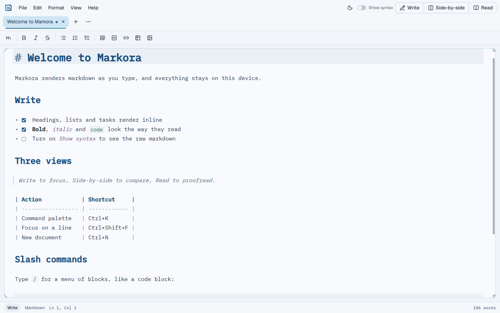
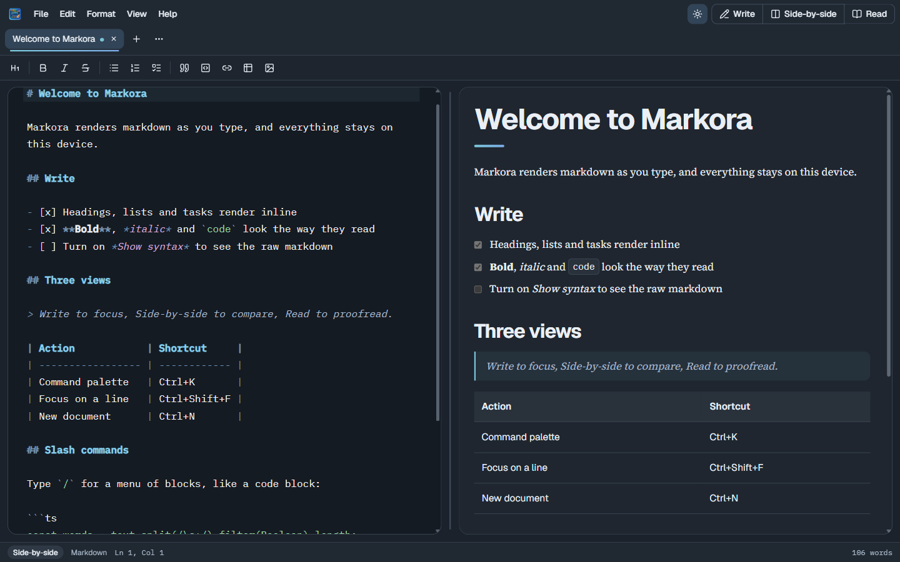
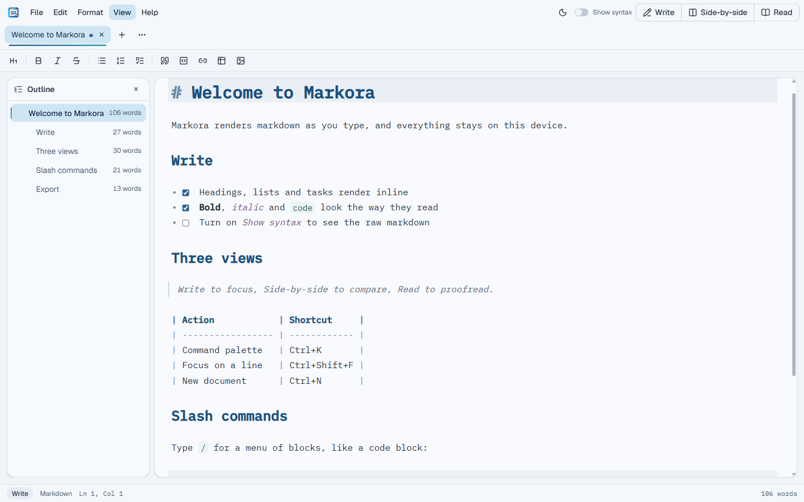
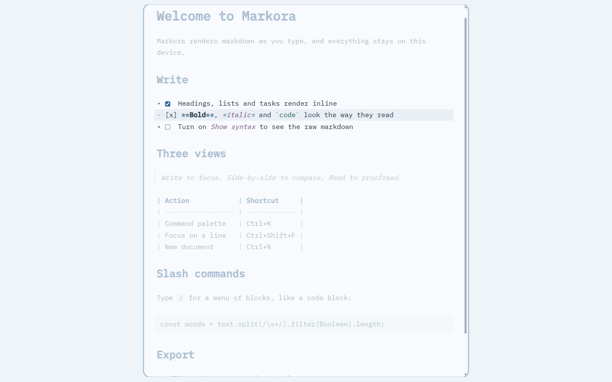
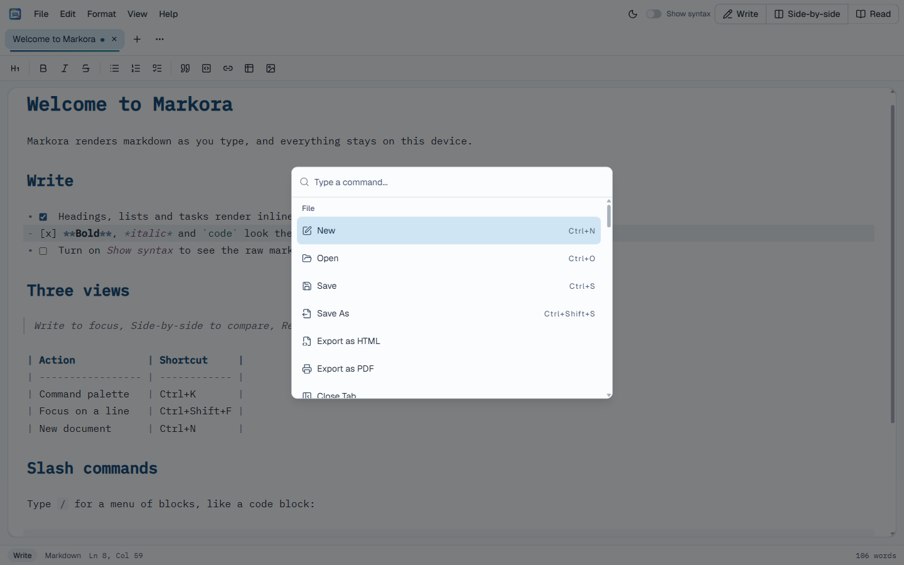

# Markora

Markora is a markdown editor available as both a native desktop app and a browser-based local-first web app.

**Desktop** — built with Tauri v2, React, TypeScript, CodeMirror 6, Zustand, and Rust. Markdown rendering and file I/O happen in Rust.

**Web** — runs in the browser with no account or server required. Uses the File System Access API where available, and falls back to IndexedDB-backed browser workspaces. Markdown rendering uses a browser-side renderer.

It includes:
- three views: **Write** (markdown renders inline as you type, with a Show syntax toggle), **Side-by-side** (editor and live preview) and **Read**
- **Focus** mode that hides the chrome and dims every paragraph but the current one
- an **Outline** panel with word counts per section and drag-to-reorder sections
- a **command palette** (`Ctrl/Cmd+K`) with every command, plus a slash menu (`/`) for inserting blocks and a formatting toolbar
- find and replace, document tabs, recent files and session restore
- open and save through native dialogs (desktop) or browser file APIs (web), with import and export on the web
- export to HTML and PDF with a clean print-friendly stylesheet
- seven colour schemes, each in light and dark, plus zoom and editor settings
- a quick guided tour for new users
- in-app updates on desktop (check, download, then restart when your documents are saved)

## Screenshots

**Write.** Markdown renders inline as you type.



**Side-by-side**, here in dark mode.



**Outline.** Jump between sections, see word counts and drag sections to reorder them.



**Focus.** Everything but the current paragraph fades back.



**Command palette.** Press `Ctrl/Cmd+K` to find any command.



## Prerequisites

Before running the app, make sure you have:
- Node.js and pnpm
- Rust via `rustup`
- Tauri desktop prerequisites for your OS

Windows:
- Rust MSVC toolchain
- WebView2 runtime
- Microsoft C++ Build Tools if Rust or Tauri asks for them

## Install

```bash
pnpm install
```

## Run The App

Start the desktop app in development mode:

```bash
pnpm tauri dev
```

What happens:
- Vite starts the frontend dev server on `http://127.0.0.1:1420`
- Tauri launches the native desktop window
- frontend code calls Rust commands through Tauri `invoke(...)`

If you only want the frontend dev server without the native shell (runs as a browser web app):

```bash
pnpm dev
```

## Test And Verify

Run the frontend tests:

```bash
pnpm exec vitest run
```

Run the TypeScript check:

```bash
pnpm exec tsc --noEmit
```

Run the Rust tests:

```bash
cd src-tauri
cargo test
```

## Build

Build the frontend bundle:

```bash
pnpm build
```

Build the desktop app:

```bash
pnpm tauri build
```

## Project Structure

```text
src/
  App.tsx                         App shell, keyboard shortcuts, file operations
  platform/
    runtime.ts                    Detects desktop vs web at runtime
    files/
      types.ts                    FileAdapter interface
      desktop.ts                  Tauri file adapter
      web.ts                      Browser file adapter (File System Access API + import/export)
    markdown/
      types.ts                    MarkdownAdapter interface
      desktop.ts                  Tauri markdown adapter (delegates to Rust)
      web.ts                      Browser markdown adapter (marked + DOMPurify)
    persistence/
      web.ts                      IndexedDB workspace snapshot persistence
    links/                        Opens external links (desktop opener plugin / browser)
    updates/                      In-app updater (real on desktop, a no-op on web)
  store/
    document/                     Zustand workspace/project/tab/document state
  features/
    commands/                     Command palette entries and menu layout
    document/                     Display name and word count helpers
    editor/                       Toolbar actions, slash commands, find/replace, live inline
                                  rendering (live/) and paragraph dimming (focus/)
    export/                       HTML and PDF export
    outline/                      Heading extraction, section moves, scroll-to-heading
    preview/                      Link classification and preview helpers
    session/                      Saves and restores open tabs
    settings/                     Settings schema, colour schemes, API (desktop + web), store
    shortcuts/                    Platform-aware shortcut labels
    theme/                        Theme store
    tour/                         Guided tour stops and state
    updates/                      Update store and launch check
    workspace/                    View mode, Focus and Outline state, editor status
  components/
    editor-page/
      editor-pane/                CodeMirror 6 editor
      preview-pane/               Live HTML preview
      workspace/                  Split pane layout
      view-mode-switcher/         Write / Side-by-side / Read and Show syntax
      outline-panel/              Headings with word counts and drag handles
      command-palette/            Ctrl/Cmd+K command search
      find-bar/                   Find and replace
      formatting-toolbar/         Formatting bar
      slash-command-menu/         "/" block menu
      top-bar/                    Command bar and menus
      tab-strip/                  Document tabs
      footer-status-bar/          Word count and cursor position
      tour/, tour-prompt/         Guided tour
    settings-page/                Settings, including the Updates card
    ui/                           shadcn/ui components
  app/
    app-shell/                    Root layout shell
    hooks/                        Autosave, session restore, external open, export, updates,
                                  keyboard shortcuts, theme sync

src-tauri/
  src/
    lib.rs                        Tauri command and plugin registration
    commands/
      markdown.rs                 Rust markdown rendering (pulldown-cmark)
      file.rs                     Rust file I/O commands
      launch.rs                   Files the app was launched with ("Open with")
      settings.rs                 Persisted settings
```

## UI And Themes

The interface is built on [shadcn/ui](https://ui.shadcn.com) (Radix primitives + Tailwind CSS v4). The shadcn components live in `src/components/ui/` and are owned by this repo, so edit them directly.

**Themes.** `src/styles/themes.css` defines seven colour schemes, each in light and dark, in OKLCH:

| Scheme (setting value) | Look |
| --- | --- |
| Aurora (`standard`) | Cool indigo ink with a violet to cyan brand gradient |
| Ember (`sepia`) | Warm graphite and amber; cream paper with a burnt-orange accent in light |
| High Contrast (`high-contrast`) | Black and white, strong borders, no decoration |
| Moss (`moss`) | Muted green on warm grey; cream paper in light, slate green in dark |
| Frost (`frost`) | Calm arctic blue-grey with a frost-blue accent. The default |
| Rosé (`rose`) | Dusty rose and gold; cream dawn in light, deep plum in dark |
| Ink (`ink`) | Pure grayscale: no hue at all, only errors stay red. Links get an underline and inline code a tint instead of a colour |

Moss, Frost and Rosé are inspired by [Everforest](https://github.com/sainnhe/everforest) (sainnhe), [Nord](https://www.nordtheme.com) (Arctic Ice Studio) and [Rosé Pine](https://rosepinetheme.com); all three are MIT licensed. The colours are retuned to pass the contrast checks below, not copied. Aurora, Ember, High Contrast and Ink are original.

**Adding a scheme.** Add it to `COLOR_SCHEMES` in `src/features/settings/color-schemes.ts` (the type, settings, View menu, command palette, window colour and Settings swatches all follow that list), add its light and dark blocks to `themes.css`, and add the variant to the `ColorScheme` enum in `src-tauri/src/commands/settings.rs`. Tests fail until all three agree.

To change a colour, edit it in `themes.css`. `src/styles/theme-contrast.test.ts` then checks every scheme and mode for WCAG AA contrast (4.5:1 text, 3:1 focus rings) and that no token is missing, so a bad tweak fails in `pnpm exec vitest run`. Dark mode is the `.theme-dark` class that `AppShell` sets on `<html>`; the editor's syntax colours are the `--syntax-*` tokens, so the editor follows the theme with no rebuild.

Any element can preview a scheme with `data-swatch-scheme` and `data-swatch-mode` (the Settings swatches use this).

**Adding a shadcn component:**

```bash
npx shadcn@latest add <component> --yes
```

The CLI needs two follow-ups in this project:

1. It rewrites `import { cn } from "@/lib/utils"` to `from "cn"` and installs an unrelated npm package called `cn`. Change the imports back to `@/lib/utils` and run `pnpm remove cn`.
2. Remove any `"use client"` line it adds, and any Next.js-only dependency (for example `next-themes`).

## Platform Notes

- On desktop, markdown rendering and file I/O go through Rust Tauri commands.
- On web, the app detects `window.__TAURI_INTERNALS__` to choose adapters at startup.
- Web file access uses the File System Access API when available; falls back to `<input type="file">` import and `<a download>` export.
- Web workspace state is persisted to IndexedDB and rehydrated on next load.
- In-app updates (check, download, restart) are desktop only. Releases are built and published by `.github/workflows/release.yml` on `v*` tags.
- See [docs/markora-web-capabilities.md](docs/markora-web-capabilities.md) for the full web capability reference.

## License

[MIT](LICENSE) © 2026 Kelvin Kiprop. See the [privacy policy](https://kelvink96.github.io/markora/privacy.html) and [terms of use](https://kelvink96.github.io/markora/terms.html).
